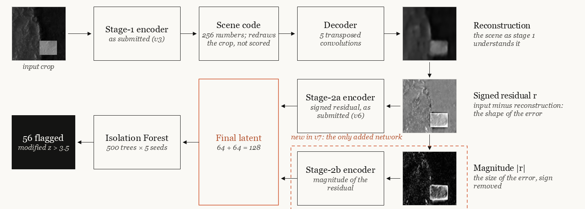
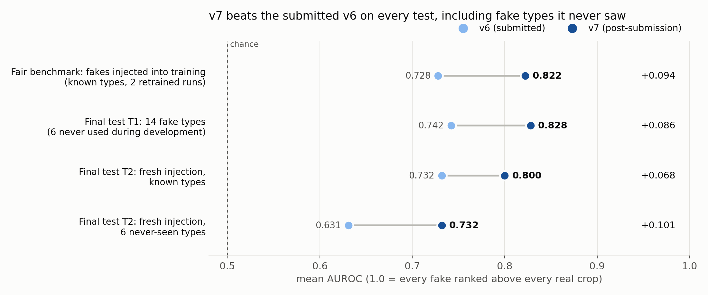
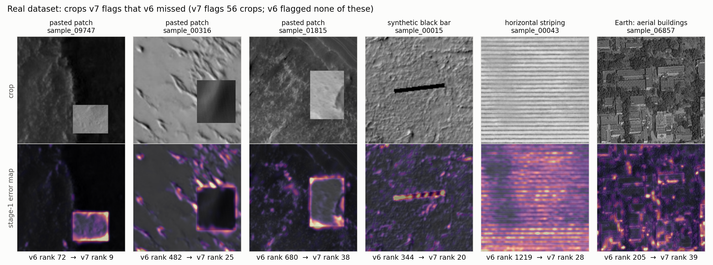

# Iteration v7 (post-submission)

> **Not part of the Round 1 submission.** Round 1 was graded on **v6** (the rest of this repository:
> threshold 0.5251, 48 flags), which is unchanged. v7 was developed after the 10 September 2026 deadline.
> It reuses the submitted v3 and v6 checkpoints exactly and adds **one** new network.

## Summary

v6 turns every crop into 320 numbers: 256 that describe the scene, plus 64 that describe **the shape
of what the autoencoder got wrong**. Those 64 numbers capture the *shape* of an error much better than
its *size*. v7 keeps every submitted network exactly as it was and adds **one more small autoencoder**
that encodes **how big the error is**. The Isolation Forest then scores the two error codes together.

Before trusting the result, we found and fixed a flaw in our own benchmark (it rewarded memorisation),
then tested v7 on a fairer benchmark, with the final tests written down before they were run.

| | v6 (submitted) | v7 |
|---|---|---|
| Fair benchmark (fakes injected into training) | 0.728 | **0.822** |
| Final test T1 (14 fake types, 6 never used in development) | 0.742 | **0.828** |
| Final test T2, never-seen fake types | 0.631 | **0.732** |
| Flags on the competition data | 48 | **56** |

(Mean AUROC: the chance that a planted fake outranks a real crop; 0.5 = coin flip.)

On the competition data, v7 newly flags three pasted patches, the black bar, a striped crop and an
Earth image of buildings that v6 missed.

---

## 1. Recap: what v6 does

1. **Stage 1** (an autoencoder trained from scratch) squeezes each 227 × 227 crop into **256
   numbers** (the *scene code*) and redraws the crop from them. It has learned what normal Mars looks
   like, so unusual content is redrawn badly.
2. **Residual**: the original minus the redrawing, pixel by pixel, a map of *what stage 1 got wrong*,
   stored as a picture where mid-grey means "no error": `128 + 127 · clip(4 · (x − x̂), −1, 1)`.
3. **Stage 2** (a second autoencoder) squeezes that residual picture into **64 numbers**.
4. The **Isolation Forest** scores the 320 numbers (256 + 64). The **modified z-score rule**
   (M > 3.5) turns the scores into 48 flags.

## 2. The problem v7 fixes

**Symptom.** On the planted-fakes benchmark, the raw reconstruction error alone separated fakes from
real crops better than v6's latent did (AUROC **0.835** against **0.775**), and v6's 64-number residual
code on its own (0.790) beat the full 320-number latent. The evidence was there, but the latent was not
carrying all of it.

**Diagnosis: shape, not size.** v6's stage 2 encodes the **signed** residual, `x − x̂`. For ordinary
terrain that residual is a zero-mean texture of small positive and negative ripples. A 64-number code of
it keeps the *shape* of the mistake (a rectangle outline, a straight line, a lattice) but only weakly
*how badly* stage 1 failed: when an encoder summarises a region, "too bright" and "too dark" errors
partly cancel. In the *magnitude* picture, `|x − x̂|`, every error is positive, so a large failure adds up.

**Fix.** Add a code for the **size** of the error, without touching anything that was submitted.

## 3. What v7 is

| Part | What it is | New in v7? |
|---|---|---|
| **Stage 1** | v3 exactly as submitted (`outputs/v3/model.pt`): 256-number scene code, no-data masking, 0.84 (1 − SSIM) + 0.16 L1 + 0.1 gradient-L1 loss, 30 epochs | No |
| **Stage 2a** | v6's stage 2 exactly as submitted (`outputs/v6/model.pt`): 64-number code of the **signed** residual | No |
| **Stage 2b** | a **new** 64-number autoencoder of the **magnitude** of the residual (`weights/stage2b_abs64.pt`) | **Yes, the only new network** |
| **Forest input** | **[2a \| 2b] = 64 + 64 = 128 numbers** | Yes (v6: [scene \| 2a] = 320) |
| **Isolation Forest** | 500 trees, 256 samples per tree, 5 seeds averaged | No |
| **Threshold** | modified z-score > 3.5 → **0.5105**, **56 flags** | Same rule |

**Stage 2b in detail**
- **Input picture:** `clip(4 · |x − x̂|, 0, 1)`: black means no error, white an error of 0.25 or more
  (0–1 pixel scale). No-data pixels are set to zero error.
- **Network:** the submitted stage-2 design with a 64-number code (about 4.8 million weights).
- **Loss:** as stage 2a, **MSE + 0.5 · L1**, on valid pixels only.
- **Training:** the submitted recipe: 30 epochs, AdamW, one-cycle schedule (peak 1e-3), batch 64, flips,
  10% held out, seed 42.

The scene code still exists: stage 1 needs it to redraw the crop, without which there is no residual. It
is only left out of the forest's input in the headline v7. The variant **"v7 + scene"** (the scene code
reduced to 64 numbers by PCA, plus 2a and 2b, 192 numbers) is reported alongside and scores about the same.

**Why two codes, not one bigger one.** On the fair injection benchmark (mean over 3 retrained runs,
`results/r3a_local.csv`): signed code only 0.701, magnitude code only 0.770, **both 0.797**. On the
development benchmark, doubling either code to 128 numbers did not help (signed 0.776, magnitude 0.808,
against 0.856 for the pair): the gain comes from two different kinds of information, not more numbers.

## 4. How the gain was checked

### 4.1 A flaw in our original benchmark
Training stage 1 for **100 epochs** instead of 30 lifted the original planted-fakes benchmark to
**0.906**, but its error on held-out crops got *worse* while its error on training crops improved: it was
**memorising**. That benchmark compared planted fakes the model had never seen with real crops it had
trained on, so a memorising model could separate *seen* from *unseen* without detecting anything.

| Model | Seen-vs-unseen AUROC | Meaning |
|---|---|---|
| 100-epoch stage 1 | 0.593 | recognises its training crops |
| v6 (submitted, 30 epochs) | **0.478** | about chance: no memorisation |
| v7 | **0.498** | about chance: no memorisation |

### 4.2 A fairer benchmark: fakes injected into the training data
In the real task the organisers' fakes are inside the crops the autoencoder trains on. The fair benchmark
(`code/p2.py`) copies that:
1. turn **240** clean crops (30 for each of 8 fake types; **2.3%** of the data) into fakes, replacing the originals;
2. **retrain the whole pipeline** on this contaminated dataset;
3. score the injected crops against all the others.

On it, stage-1 training length makes no difference (30 / 60 / 100 epochs: 0.822 / 0.818 / 0.813), so
v7 keeps the submitted 30-epoch stage 1.

### 4.3 Final tests fixed in advance
The selection rule and the final tests were written down first (`PREREGISTRATION.md`) and each final
test was scored once:
- **T1:** 300 fresh fakes of each of 14 types: the 8 development types plus **6 never used in
  development** (brightness-matched pasted patches, soft curved seams, bursts of read-out noise,
  over-exposed blobs, centre-pivot irrigation circles, field patchworks).
- **T2:** fresh injection sets with new seeds, pipeline retrained: known types, and the 6 new types.

## 5. Results

**Fair injection benchmark** (known types, 2 retrained runs)

| | Splice | Glitch | Earth-like | **Mean** | Recall at threshold | Precision at threshold |
|---|---|---|---|---|---|---|
| v6 recipe | 0.678 | 0.663 | 0.907 | 0.728 | 10% | 39% |
| **v7 recipe** | **0.766** | **0.829** | 0.863 | **0.822** | **26%** | **56%** |

**Final tests** (each scored once)

| Test | v6 submitted | **v7** | v7 + scene |
|---|---|---|---|
| T1: all 14 types | 0.742 | **0.828** | 0.820 |
| T1: 8 known types | 0.770 | **0.853** | 0.836 |
| T1: 6 never-seen types | 0.706 | 0.794 | **0.800** |
| T2: fresh injection, known types | 0.732 | 0.800 | **0.817** |
| T2: fresh injection, 6 never-seen types | 0.631 | 0.732 | **0.742** |

v7 beats v6 on every test, including fake types never used in development, and improves 12 of the 14
types in T1.

## 6. On the competition data

Same forest and the same k = 3.5 rule: threshold **0.5105**, **56 crops flagged** (v6: 48). The four
Earth images rank **1, 2, 3 and 7** (v6: 1, 3, 5 and 6). Full scores: `results/v7_scores_real.csv`.

| Crop | What it is | v6 rank | v7 rank |
|---|---|---|---|
| sample_09747 | pasted rectangular patch | 72 | **9** |
| sample_00316 | pasted rectangular patch | 482 | **25** |
| sample_01815 | pasted rectangular patch | 680 | **38** |
| sample_00015 | synthetic black bar | 344 | **20** |
| sample_00043 | horizontal striping | 1,219 | **28** |
| sample_06857 | Earth: aerial view of buildings | 205 | **39** |

v7 stopped flagging mostly genuine rare terrain such as deep craters. The two polar observations that
supplied 12 of v6's 48 flags supply 2 of v7's 56, and flags now come from 37 source observations
instead of 30. Still missed: the two thin streaks (rank 2,517 → 1,554) and the dead-pixel blocks
(479 → 8,951).

## 7. Trade-offs and what did not work

**Trade-off.** v7 is less sensitive to regular man-made textures: orchard-like grids 0.884 → 0.787 and
field patchworks 0.957 → 0.831 (T1). The scene code carries that "this texture is not Martian" signal;
"v7 + scene" recovers the patchworks (0.939).

**Tried and rejected on the way to v7** (development benchmark)

| Idea | Result | Why it failed |
|---|---|---|
| Stage 2 on the log error-energy heatmap | 0.761 | the log scale flattens the whole-frame failures that identify Earth images |
| Smaller stage-1 code (128 / 64 / 32) | 0.69 / 0.57 / 0.54 | a tight bottleneck organises the code around brightness |
| Wider stage 1 (2× channels) | no gain | capacity was not the limit |
| Stage-2 gain 2 or 8, 16–256 numbers, 60–100 epochs | 0.77–0.80 | the signed code saturates |
| Stage 1 for 100 / 200 epochs | looked like 0.906 / 0.926 | memorisation (section 4.1) |

**Later search.** With its own rules fixed in advance (`PREREG_r3.md`; a candidate had to beat v7 by
more than 0.015), structural (SSIM-based), edge and dilated residual codes, loss trimming and
refine-and-retrain were tried. The best alternative scored 0.801 against v7's 0.797, inside the noise,
so v7 remains the best model. The SSIM-based error map was the weakest residual code (0.609 alone).

## 8. Limits

1. The planted fakes are ours; the organisers' may differ. The newly flagged real crops (section 6) are
   the closest thing to ground truth, and they point the same way.
2. v7 trades some sensitivity to man-made grids for much better splice and glitch detection.
3. Small isolated defects (dead-pixel blocks, thin streaks) are still averaged away.
4. v7 was designed after the Round 1 data had been seen, which is why the final tests were fixed in
   advance and include fake types never used in development.

## 9. Reproducing

All commands run from the repository root, after the competition data has been set up as in the main
README (`data/`). The submitted checkpoints in `outputs/v3/` and `outputs/v6/` are used unchanged. If the
notebook's cache (`cache/images_u8.npy`, `cache/nodata_masks.npy`) is missing, it is rebuilt from `data/`.

| Command | What it does |
|---|---|
| `python post_submission_improvements/iteration_v7/code/score_v7.py` | **v7 on the competition data from the saved weights**, no training: prints threshold 0.5105, 56 flags, Earth-image ranks 1, 2, 3, 7, and writes `results/v7_scores_real_recomputed.csv`. Reproduces `results/v7_scores_real.csv` exactly |
| `python post_submission_improvements/iteration_v7/code/train_stage2b.py` | retrains stage 2b from the submitted stage 1 (GPU recommended). GPU training is not bit-for-bit deterministic, so the weights differ slightly |
| `python post_submission_improvements/iteration_v7/code/p2.py --tag P30_d0 --s1-epochs 30 --inject dev --seed 100` | one run of the fair injection benchmark (retrains the whole pipeline) |
| `python post_submission_improvements/iteration_v7/code/t1.py` then `python post_submission_improvements/iteration_v7/code/evaluate.py V7 --split test` | final test T1 and the seen-vs-unseen check |

The reported T1 numbers came from an earlier training of stage 2b with the same recipe; `weights/stage2b_abs64.pt`
is the network behind the competition-data results in section 6, so T1 recomputed with it can differ slightly.
Scripts write regenerated outputs to `runs/`, `p2/`, `p3/` and `cache/` inside this folder (git-ignored).

## 10. Files

| Path | Contents |
|---|---|
| `CHANGELOG_v7.md` | engineering-journal entry for v7: symptom → diagnosis → fix |
| `PREREGISTRATION.md`, `PREREG_r3.md` | selection rules and final tests, fixed before scoring |
| `weights/stage2b_abs64.pt` | the one new network (stage 2b) |
| `code/score_v7.py`, `code/train_stage2b.py` | reproduce v7's result; retrain stage 2b |
| `code/r2lib.py` | shared helpers: held-out fake generators, `stage2_images()` (signed and magnitude pictures), evaluation |
| `code/p2.py` | fair injection benchmark |
| `code/t1.py`, `code/evaluate.py` | final test T1, seen-vs-unseen check, benchmark scoring |
| `code/run.py`, `code/p1_check.py`, `code/exp_blocks.py` | development experiments (stage-2 variants, memorisation check, latent-block analysis) |
| `code/p3.py`, `code/p3_eval.py` | the later search (section 7) |
| `code/make_v7_figs.py` | the figures in `figs/` |
| `results/v7_scores_real.csv` | v7 and v6 Novelty Scores, ranks and flags for all 10,422 crops |
| `results/results_dev.csv`, `results/results_test_cluster.csv`, `results/r3a_local.csv` | development, final-test and later-search results |
| `results/stage2b_abs64_history.csv` | stage-2b training curve |
